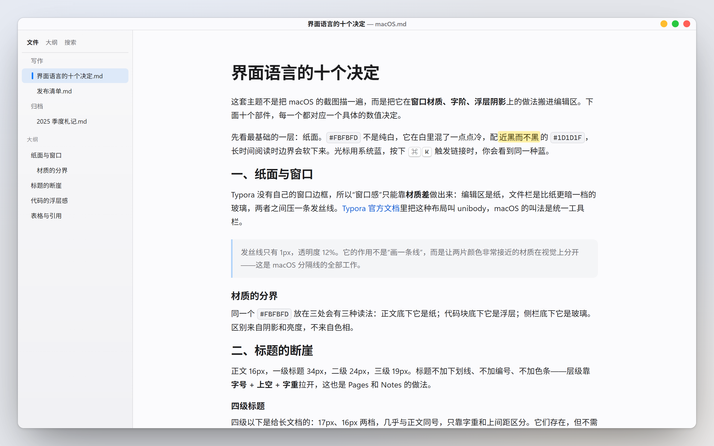
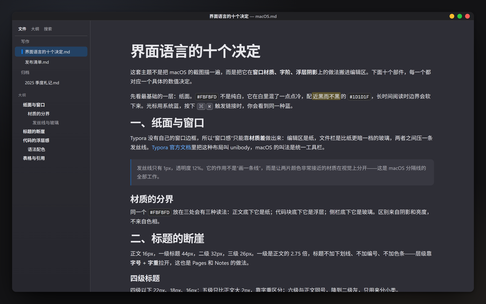
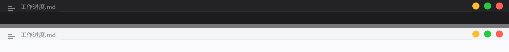
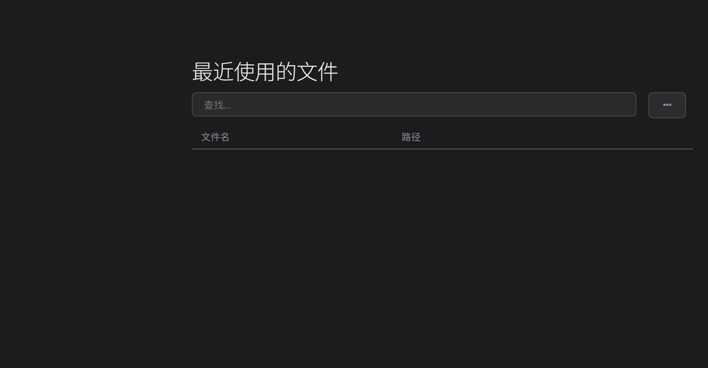

# Typora macOS 主题

把 macOS 的界面语言搬进 Typora：纸面分层、发丝线、系统蓝、字阶断崖。浅色与深色各一套，
两份 CSS 用同一套十二节结构，改一处两处一起变。Windows 版还能接管窗口标题栏，
把红黄绿三个圆点放到右上角。


## 预览

| MacosLight | MacosDark |
| :---: | :---: |
|  |  |

窗口外壳（上深下浅，Windows + Unibody 模式）：



## 它做了什么

这套主题不是把 macOS 截图描一遍，而是把界面里那几条规则搬过来。

- **纸面不纯白**。正文底色 `#FBFBFD`，在白色里兑一点冷；深色 `#2E2E36`，石墨而不发黑。
  长时间阅读时边界会软下来，不会像纯白背景那样发刺。
- **材质靠亮度分层，不靠色相**。编辑区是纸，侧栏是比纸暗一档的玻璃，两者之间压一条
  1px、透明度 12% 的发丝线。同一个 `#FBFBFD` 放在三处会有三种读法——区别来自阴影和亮度，
  不来自颜色。
- **字阶有断崖**。正文 16px / 行高 1.72，一级标题 44px、二级 32px、三级 26px、四级 22px，
  五级 18px、六级 16px。标题不加下划线、不加编号、不加左侧色条，层级只靠字号和字重。
  一级是正文的 2.75 倍、二级 2 倍、三级 1.6 倍，扫一眼就知道自己在哪一层。
- **圆角按角色分档，阴影分三层**：浮层、卡片、控件各有一套。
- **语法色取 Xcode**。浅色下关键字紫、字符串红、注释灰绿；深色另配一套，避免在暗底上发光。
- **打印自动翻白**。深色主题在 `@media print` 里重新声明浅色令牌，导出 PDF 直接得到白纸黑字。
- **弹框只有一层材质**。对话框的定位容器不画底色，材质、圆角、投影只给内容卡片，标题下压一条发丝线；下拉框、输入框在所有弹框里都是同一块凹槽，深色下不会露出原生的纯黑控件。主按钮另有悬停态——浅色下再暗一档、深色下再亮一档，不会像宿主那样一悬停就褪成灰底。
- **偏好设置页也归主题管**。Typora 的偏好设置是个独立 webview，但它同样加载当前主题的 CSS，所以那里的字号、下拉框高度、行距、搜索框和选中态都跟着一起改，不会正文变大、设置界面还是小字；下拉框和左边的说明文字也是垂直居中对齐的。
- **菜单面板的字号也放大了**。左侧栏目从 14px 提到 16px，标题与「打开…」「导入…」「打开 / 导入 / 最近使用的文件」那几个 40/30px 的细体大标题压到 26/24px 并加粗；「打开…」「导入…」这对长按钮从方角细线框改成圆角卡片，与标题并排、宽度顶到行尾；最近文件区的搜索框和表格铺满整行。
- **大纲分六级**。侧栏大纲一级加粗用正文色，二级缩进 18px 起，往下逐级缩进、变浅、变小；
  宿主自己那条分级缩进会被主题的 `#outline-content .outline-item` 盖掉，所以按 ID 权重逐级补了回来。
- **正文版心 900px**（窗口宽于 1500px 时放宽到 980px），左右各留 40px，中文一行约 51 字。源代码模式用同一组宽度。

### 顺手补的三处原生界面

Typora 的这几块界面不归主题管，用的是默认肤色，深色主题下会露出白块。主题按真实 DOM 把它们接管了：

| 位置 | 原来 | 现在 |
| --- | --- | --- |
| 「最近使用的文件」面板的 `…` 按钮、表格斑马纹 | 纯白的 `#EEEEEE` / `#F7F7F7` | 深色下换成 `--surface-3` 底 + 描边的控件 |
| 源代码模式 | 每行从窗口最左贴边，行首的 `#`、`-` 被裁掉 | 保住宿主 60px 的 gutter 定位基准，行号与标记都完整 |
| 窗口标题栏 | Classic 模式由系统接管，CSS 碰不到 | 28px 高、发丝线、居中标题，右上角三个 18px 圆点 |

最近文件面板（深色）：



圆点悬停时会亮起符号（`×` / `−` / `+`，800 字重），并在下方浮出中文提示：
关闭 / 最小化 / 最大化 / 还原 / 取消置顶。

## 安装

### 1. 放文件

Typora 的用户主题目录：

| 系统 | 路径 |
| --- | --- |
| Windows | `%APPDATA%\Typora\themes` |
| macOS | `~/Library/Application Support/abnerworks.Typora/themes` |
| Linux | `~/.config/Typora/themes` |

把仓库里的文件按下面的相对位置放进去：

```
themes/
├── macos-light.css
├── macos-dark.css
└── macos-parts/
    └── window.css        ← 窗口标题栏样式，独立文件
```

`macos-parts/window.css` 不能改名、不能挪位置——两份主题的第一行都是
`@import "macos-parts/window.css";`，路径一变就会静默失效（圆点消失）。

### 2. 重启 Typora

主题 CSS 在启动时读入，装完要重启一次（或先切到别的主题再切回来）。

### 3. 选主题

偏好设置 → 外观 → 主题，列表里会看到 **MacosLight** 和 **MacosDark**
（Typora 把文件名转成驼峰显示）。

## 让窗口标题栏生效（仅 Windows）

默认的窗口样式是 **Classic**，标题栏由系统画，CSS 摸不到它。要换成 Typora 自绘的标题栏：

> 偏好设置 → 通用 → **Window Style** → 选 **Unibody** → 重启 Typora。

（各版本菜单位置可能略有差异，认「Window Style」「applied after restart」这几个字就行。）

重启后窗口顶部就是 28px 的主题标题栏：汉堡菜单与居中文件名在左，黄绿红在右。

代价要提前知道：切到 Unibody 后，窗口不再有系统提供的圆角、外阴影和系统右键菜单，
这些会一起没掉。如果你更在意窗口的圆角，就留在 Classic——正文样式照样生效，只是没有圆点。

## 使用

### 只想要窗口样式，不想换正文

`macos-parts/window.css` 是独立的，不依赖两份主题里的任何变量——每个令牌都写了兜底值。
在任意主题 CSS 的**第一行**加一行即可：

```css
@import "macos-parts/window.css";
```

`@import` 必须放在所有规则之前，否则会被忽略。

### 改颜色

颜色与尺寸集中在 `:root`，改一个值全文生效：

```css
:root {
  --bg-color: #FBFBFD;         /* 正文底色 */
  --text-color: #1D1D1F;       /* 正文 */
  --accent-color: #007AFF;     /* macOS 系统蓝：光标、选中、链接装饰 */
  --link-color: #0A5CD6;       /* 正文链接（比系统蓝深一档，保证对比度） */
  --side-bar-bg-color: #F1F1F4;/* 侧栏玻璃 */
  --surface: #F4F5F7;          /* 卡片、提示卡底 */
  --surface-2: #F2F3F6;
  --surface-3: #EDEEF1;        /* 次级控件、悬停底 */
  --hairline: rgba(60, 60, 67, .12);      /* 发丝线 */
  --hairline-strong: rgba(60, 60, 67, .22);
}
```

深色主题的 `:root` 同名不同值，两份一起改就是一套。

### 改圆点

圆点的顺序、尺寸、间距都在 `macos-parts/window.css` 里：

```css
#top-titlebar #w-min       { order: 1; }   /* 黄 · 最小化 */
#top-titlebar #w-max-group { order: 2; }   /* 绿 · 最大化 */
#top-titlebar #w-close     { order: 3; }   /* 红 · 关闭 */
```

三个圆点是 `18px`，`gap: 11px`，右边距 `12px`。想放回 macOS 原生的左边排列：
把三行 `order` 换成 `3 / 2 / 1`，再给 `#w-traffic-lights` 加 `float: left`、去掉 `padding-right`。

### 字体

字体栈会依次尝试 SF Pro Text → Segoe UI Variable → Segoe UI → PingFang SC → 微软雅黑，
最后落到 `system-ui`。装了 SF Pro 就接近原生，没装时用的是系统自带字体——观感仍接近，
但不是原生 SF。想换字体，改 `--font-text` / `--font-display` / `--monospace` 三个令牌即可。

## 常见问题

**看不到右上角的圆点？**
还在 Classic 模式。切成 Unibody 并重启（见上一节）。

**软件更新会覆盖主题吗？**
不会。主题全在用户目录（`%APPDATA%` 或 `~/Library`），Typora 的安装目录一个文件都没动。
升级、覆盖安装都不影响。只有卸载时勾选「删除用户数据」才会丢。

**Typora 大改版会不会失效？**
正文样式基本不受影响；标题栏依赖 DOM 的元素 id（`#w-close`、`#w-min` 这些），
真被改掉时圆点会静默消失、不报错，这时更新 `macos-parts/window.css` 里的选择器就行。

**深色下还有白块？**
面板和源代码模式这两处已经补过。如果遇到别的白块，带上截图提 issue。

**macOS / Linux 上能用吗？**
正文与侧栏样式可以；窗口标题栏那部分是 Windows 版 Typora 特有的 DOM（`#top-titlebar`），
在其他平台会安静地不生效，不会报错。

**这是不是直接把 macOS 截图做的背景图？**
不是。全部由 CSS 规则写成，没有背景图、没有图片素材，改了颜色就整套跟着变。

## 目录结构

```
typora-macos-theme/
├── macos-light.css        # 浅色主题，第一行 import window.css
├── macos-dark.css         # 深色主题，同结构
├── macos-parts/
│   └── window.css         # 窗口标题栏（交通灯、悬停提示），可单独使用
├── docs/                  # 截图
└── LICENSE
```

## 已知限制

1. 标题栏需要 Unibody 模式；切了就没有系统窗口圆角、外阴影和系统右键菜单。
2. 圆点在右侧、红色在最右，是照顾 Windows 的使用习惯，不是 macOS 原生的左侧排列（可自行改回）。
3. 极窄窗口（< 700px）下侧栏会按 Typora 自身逻辑收起，标题栏文件名会截断——这是 Typora 的行为，主题没有覆盖。
4. 只在 Windows 上完整验证过；其他平台的正文样式与 Windows 同源，但标题栏不生效。

## 许可

MIT，见 [LICENSE](LICENSE)。
